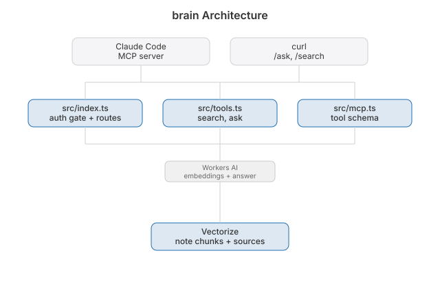

# brain

  [](https://github.com/nulljosh/brain)


My notes, searchable. Ask them a question and get an answer with sources.

A Cloudflare Worker, Vectorize and Workers AI. No model is trained. The notes stay the truth and the model only reads them.

Live: **https://brain.heyitsmejosh.com**. Every route needs a bearer token. These are private notes.

## Layout
- `src/tools.ts`: `search_notes`, `ask_notes`, `ingest`. The only file that knows how retrieval works. REST and MCP both call it, so they can't drift apart.
- `src/mcp.ts`: stateless JSON-RPC MCP transport.
- `src/index.ts`: router and auth.
- `ingest.mjs`: walks the Obsidian wiki and every `roadmap.md`, `CLAUDE.md` and `README.md` under `~/Documents/Code`. Chunks to 1500 characters, posts in batches of 50. Chunk ids are content hashes, so running it twice changes nothing.
- `test.mjs`: the chunker's self-check. `node test.mjs`

## Endpoints
| | |
|---|---|
| `GET /api/search?q=&limit=` | matching passages verbatim, with sources |
| `GET /api/ask?q=` | a written answer with sources. Slower, a model writes it |
| `POST /api/ingest` | re-index; body `{ chunks: [{ id, text, source }] }` |
| `POST /mcp` | Model Context Protocol, same two tools |

## Use
```bash
# set -a, not plain source. ingest.mjs reads BRAIN_TOKEN from the environment.
# A bare `source` leaves it unexported, node sees nothing, and every batch 401s.
set -a && source .env.local && set +a
node ingest.mjs                                    # re-index after notes change
curl -s -H "authorization: Bearer $BRAIN_TOKEN" \
  "https://brain.heyitsmejosh.com/api/search?q=what+is+blocked+on+me"
```

## As an MCP server
```bash
claude mcp add --transport http brain https://brain.heyitsmejosh.com/mcp \
  --header "authorization: Bearer $BRAIN_TOKEN"
```

## Architecture


